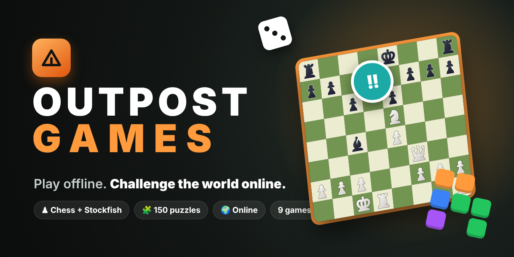

<h1 align="center">Outpost Games</h1>

<b>Play offline. Challenge the world online.</b> 
A free games app for iPhone and Android that installs from the browser, works without internet, and has real online multiplayer.

<a href="https://fr5quency.github.io/offline-games-with-online-multiplayer-/"><b>▶ Play now</b></a>

---

## ♟ Chess, done properly
- **11 bots** from 400 to **Grandmaster (2600, Stockfish)**, plus **Brilliant Mover**, an attacking gambler that never misses a brilliant sacrifice
- **Game review by Stockfish 18**, like chess.com: Brilliant !!, Great, Best… Blunder, accuracy, evaluation bar, forced mates (M7) and a talking coach
- **Learn from your mistakes**: every blunder from your game becomes a puzzle
- **150 puzzles** (mate in 1–4, brilliant sacrifices) and a **daily puzzle** with a 🔥 streak
- **19 lessons**: 10 openings and 9 gambits (Alien Gambit, King's Gambit, Fried Liver, Stafford, Englund…)
- **Play online** against anyone, or **play a friend** with a 5-digit code
- **Bot vs bot**: pick two bots and watch them fight
- Modes: Chess960, King of the Hill, Three-check, No castling, 1v1 on one phone
- **Game history**, **stats** with Elo charts, **24 achievements**, share games as **PGN** or a **picture**

## 🎮 And 8 more games
Block Puzzle (with online battles) · Sudoku · Minesweeper · Four in a Row (online too) · Merge · Solitaire · Dominoes · Backgammon

## 📱 Install it on your phone
- **iPhone:** open the link in **Safari** → **Share** → **Add to Home Screen**
- **Android:** open the link in **Chrome** → **⋮** → **Install app**

Open it once on Wi-Fi so everything (including the 7 MB chess engine) is saved for offline use.

## 🌍 Languages and looks
English and Arabic (full right-to-left layout), dark and light mode.

## 🔐 Sign in and sync
Sign in with Google to save your progress to your account and get it back on any phone.
Outpost Games and the [Outpost](https://fr5quency.github.io/outpost/) app share the same account and progress.

## Credits and licenses
- Chess engine for reviews and the Grandmaster bot: [Stockfish 18](https://github.com/official-stockfish/Stockfish) via [Stockfish.js](https://github.com/nmrugg/stockfish.js), GPL-3 (`stockfish/Copying.txt`)
- Chess pieces: "Papercut" by Nikolay Anzarov, CC BY 4.0 (`pieces/LICENSE.txt`)
- Online play: [PeerJS](https://peerjs.com/) (MIT); sign-in: Firebase JS SDK (Apache 2.0)
